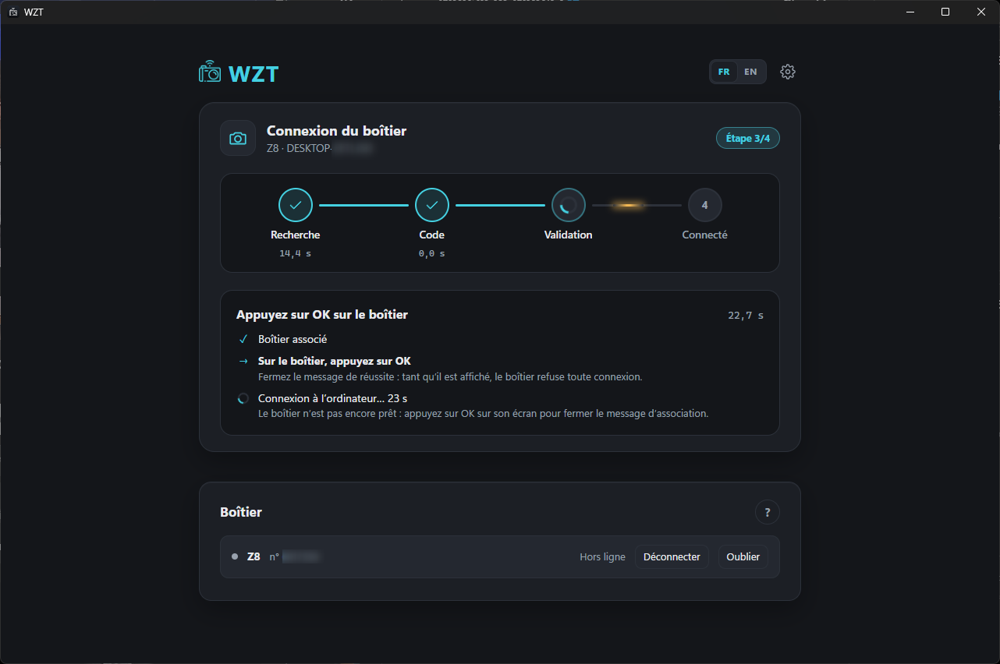
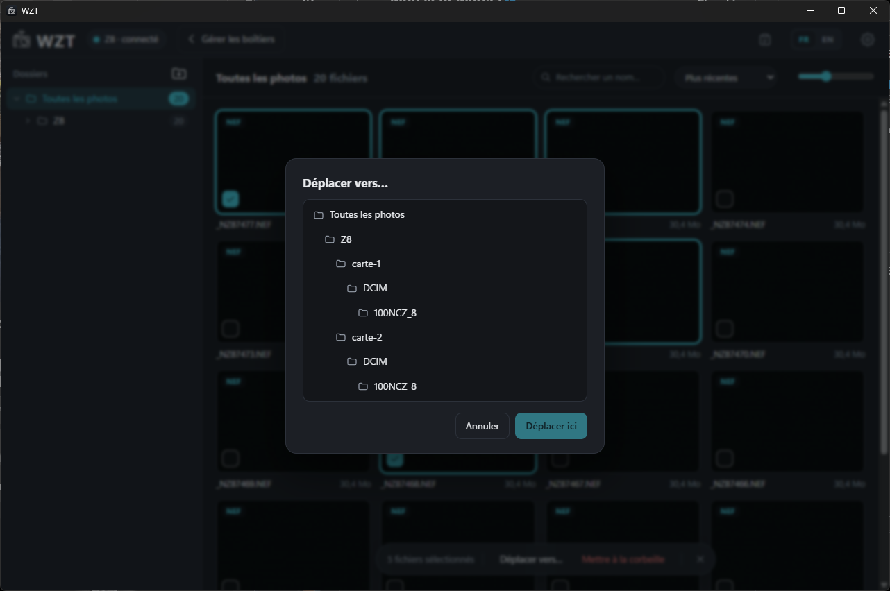
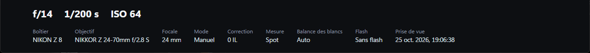
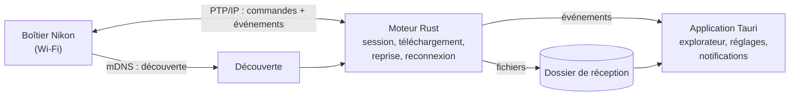

# WZT — vos photos Nikon, sans câble

**WZT reçoit en Wi‑Fi les photos d'un boîtier Nikon et les range sur l'ordinateur, sans passer par l'utilitaire officiel de Nikon (Wireless Transmitter Utility).**
Application de bureau pour Windows, macOS et Linux.

🔗 Site et téléchargement : **[wzt.aura-mag.fr](https://wzt.aura-mag.fr)** · Guide : [guide d'utilisation](https://wzt.aura-mag.fr/guide-utilisation.html)

> Ce dépôt présente le projet. Le code source est privé ; je le montre volontiers en entretien.

---

## Le problème

En studio ou en reportage, un photographe veut voir ses images sur l'ordinateur au fil de la prise de vue. Nikon propose pour cela son propre utilitaire Wi‑Fi. WZT est une alternative indépendante, pensée pour le confort d'usage, avec un explorateur de photos intégré et une version pour chaque système. Le besoin vient du terrain : je suis photographe et formateur.

## Ce que fait WZT

- **Association guidée** : WZT détecte l'ordinateur et le boîtier sur le réseau, affiche le modèle, le numéro de série et l'adresse IP, puis demande le code à 4 chiffres affiché par l'appareil. Plusieurs boîtiers peuvent être mémorisés.
- **Réception en direct** : chaque photo prise arrive sur l'ordinateur, avec une barre de progression. Les fichiers sont rangés comme sur la carte (`Modèle/carte-N/DCIM/…`).
- **Choix des fichiers** : RAW, JPEG, HEIF, vidéo, audio ; récupération des photos manquantes au moment de la connexion.

  

- **Explorateur intégré** : dossiers avec compteurs, vignettes extraites des RAW (NEF), aperçu plein écran au clavier, lecture vidéo, tri (date, nom, taille) et recherche.
- **Gestion des photos et des dossiers** : créer, renommer, déplacer, mettre à la corbeille, « Afficher dans le dossier », « Ouvrir avec… » une application installée. Sélection multiple, menu clic droit, glisser‑déposer, raccourcis F2 et Suppr. La corbeille est celle du système, donc tout reste récupérable.
- **Fiabilité** : reprise d'un transfert interrompu à l'octet près, reconnexion automatique, doublons « carte 2 » ignorés.
- **Informations de prise de vue** : ouverture, vitesse, ISO, objectif, mode, mesure, lus directement dans le fichier RAW.

  

- **Confort** : interface FR/EN, icône dans la barre système, notifications, lancement au démarrage, mises à jour automatiques signées, bouton « Copier les journaux » pour le support.

## Points techniques

| | |
|---|---|
| **Langage** | Rust (≈ 4 000 lignes, plus 300 de tests) et JavaScript (≈ 1 600 lignes pour l'interface) |
| **Interface** | Tauri 2, HTML/CSS/JavaScript, i18n FR/EN |
| **Réseau** | Implémentation du protocole **PTP/IP**, découverte des boîtiers par **mDNS** (`_ptp._tcp.local`), asynchrone avec Tokio |
| **Rétro‑ingénierie** | Les échanges propriétaires de Nikon (association par code, attente des nouvelles photos) ont été reconstitués à partir de **captures Wireshark** |
| **Images** | Extraction des JPEG intégrés aux fichiers RAW NEF, lecture EXIF et orientation |
| **Tests** | Codec vérifié octet par octet contre les paquets capturés ; scénario complet contre un **faux boîtier** (réception, dédoublonnage, coupure puis reprise) |
| **Livraison** | GitHub Actions compile et signe les installeurs pour Windows, macOS (Intel et Apple Silicon) et Linux (`.exe`, `.msi`, `.dmg`, `.deb`, `.rpm`, AppImage), puis publie la mise à jour |

### Architecture

Le moteur est une bibliothèque indépendante de l'interface : il fonctionne aussi en ligne de commande, ce qui a simplifié les tests.

## Comment je l'ai construit

J'ai conçu WZT avec l'IA (Claude) comme binôme de développement. Je fixais l'objectif, analysais les captures réseau avec elle, testais sur les boîtiers réels et décidais des choix produit. Le projet m'a appris à piloter un développement complexe dans un langage exigeant : découper le problème, faire écrire des tests qui prouvent le comportement, et livrer un logiciel installable.

## État du projet

- Version **0.1.2** (octobre 2026).
- **Testé** avec un Nikon Z8 et un Z50 II sous Windows. Les autres boîtiers Z, le D780 et le ZR sont compatibles en théorie, sans validation. macOS et Linux sont compilés mais pas encore essayés en conditions réelles.
- Limites connues : un seul boîtier connecté à la fois (limite du protocole), fichiers de plus de 4 Go non gérés, pas d'aperçu HEIF.

## Contact

**Karim Belkacem** — formateur et product builder, Bordeaux
[LinkedIn](https://www.linkedin.com/in/karimbelkacem/) · [GitHub](https://github.com/karimbel)
